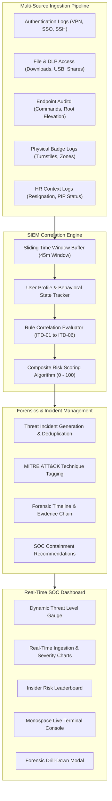

# CORREL-SIEM // Insider Threat Detection via Log Correlation System

> **Subject:** System Information and Management (Cyber Security Honours)  
> **Topic:** Insider Threat Detection via Log Correlation System – Correlate access logs to flag potential insider threat patterns.  
> **Tech Stack:** Python 3.11+, Flask REST API, Vanilla CSS (Custom Glassmorphism Cyber Theme), Vanilla JS, Chart.js.

---

## 1. Project Overview & Motivation

Insider threats are notoriously difficult to detect because authorized employees (administrators, developers, analysts) possess valid credentials and legitimate access rights to internal systems. A single log entry in isolation—such as logging in over VPN, elevating to root for a task, or copying a file—often appears benign.

**The Solution:**
**Log Correlation**. By ingesting and correlating events across disparate log streams within sliding time windows, **CORREL-SIEM** reconstructs the multi-step attack chain and calculates dynamic composite risk scores to flag malicious insider patterns in real time.

```
   [ Authentication Log ]     [ Physical Badge Log ]
            \                     /
             \                   /
     ======> [ CORRELATION ENGINE ] <======
             /                   \
            /                     \
   [ File / DLP Log ]         [ Endpoint Auditd ]
            \                     /
             +-- [ HR Context ] -+
```

---

## 2. System Architecture



---

## 3. Implemented SIEM Correlation Rules & MITRE ATT&CK Mapping

The system implements 6 correlation detection rules tailored for insider threat patterns:

| Rule ID | Rule Name | Severity | MITRE ATT&CK | Sliding Window | Detection Logic |
| :--- | :--- | :---: | :--- | :---: | :--- |
| **ITD-01** | **Off-Hours Privilege Escalation & Data Exfiltration** | `CRITICAL` | `T1078` Valid Accounts<br>`T1048` Exfiltration | 30 mins | Off-hours VPN/Badge login (21:00-06:00/weekend) + Privileged elevation (`sudo`/`runas`) + Large sensitive file download / USB transfer (>100MB / Confidential). |
| **ITD-02** | **Privilege Abuse & Security Log Tampering** | `CRITICAL` | `T1070` Indicator Removal<br>`T1548` Abuse Elevation | 15 mins | Root/Admin elevation followed immediately by commands disabling audit daemons or deleting log files (`auditctl -D`, `rm -rf /var/log/*`, `systemctl stop syslog`). |
| **ITD-03** | **Disgruntled / Departing Employee Asset Harvesting** | `HIGH` | `T1530` Data from Cloud<br>`T1485` Data Destruction | 40 mins | Employee with HR flag (`RESIGNATION_NOTICE_PENDING` or `PIP`) performing bulk exports, mass file deletions, or accessing intellectual property shares. |
| **ITD-04** | **Impossible Travel & Account Takeover** | `HIGH` | `T1078.004` Cloud Accounts<br>`T1021` Remote Services | 60 mins | Two consecutive successful logins from distant geographical locations (e.g., New York vs Frankfurt) within <90 mins, followed by internal database dumps. |
| **ITD-05** | **Cross-Department Confidential Snooping** | `MEDIUM` | `T1083` File Discovery | 30 mins | Employee repeatedly accessing `CONFIDENTIAL` or `RESTRICTED` folders owned by departments outside their assigned business unit (e.g. Sales accessing M&A files). |
| **ITD-06** | **Repeated Auth Failures + Privilege Spike** | `MEDIUM` | `T1110` Brute Force | 20 mins | Consecutive authentication failures across internal services followed by sudden credential elevation. |

---

## 4. Realistic Persona Profiles & Scenarios

The simulator models 6 distinct employee personas with baseline enterprise activities:

1. **Marcus Vance** (Senior Financial Analyst, Finance): Flight risk / competitor espionage scenario.
2. **Sarah Chen** (Lead DevOps Architect, IT Operations): Rogue admin / log tampering scenario.
3. **Elena Rostova** (Database Administrator, Infrastructure): Compromised credentials / impossible travel scenario.
4. **Alex Morgan** (Enterprise Account Executive, Sales): Cross-department proprietary snooping scenario.
5. **David Miller** (Full Stack Developer, Engineering): Benign baseline engineering workflow.
6. **Aisha Patel** (Director of People Operations, HR): Benign baseline HR workflow.

---

## 5. Key Features of the Dashboard

- **Glassmorphism SOC Aesthetics:** Deep tactical dark cyber theme with glowing neon indicators, pulse radar, and responsive layout.
- **Dynamic Threat Level Gauge:** Automatically transitions between `NORMAL`, `GUARDED`, `ELEVATED`, and `CRITICAL` based on active threats.
- **Interactive Simulation Controls:**
  - Start / Pause / Reset continuous log ingestion.
  - Multi-speed selector (1.0x, 2.0x, 5.0x, 10.0x).
  - Quick Scenario Injector (one-click simulation of realistic multi-stage attacks).
  - Custom Log Crafter (manually inject specific events during viva to demonstrate real-time correlation).
- **Forensic Investigation Modal:** Visual step-by-step attack sequence showing timestamps, source logs, raw JSON payload, and specific containment remediation steps.
- **Downloadable Forensic Report:** Instant export of comprehensive incident report (`.txt`) for viva submission or evaluation records.

---

## 6. How to Run the Project

### Prerequisites
- Python 3.9+ (Installed and available in PATH)
- Flask (`pip install Flask`)

### 1-Click Launch (Windows)
Double-click `run.bat` in this folder, or open terminal:
```bash
python app.py
```

### Accessing the Web Application
Open your web browser and navigate to:
```
http://127.0.0.1:5000
```

---

## 7. Viva / Demonstration Walkthrough Guide

1. **Open the Dashboard:** Point out the 4 KPI cards, Threat Level gauge (`NORMAL`), and empty incident feed.
2. **Start Continuous Stream:** Click **"Start Stream"**. Watch background enterprise logs stream into the Monospace Terminal and charts update in real-time.
3. **Trigger Scenario 1 (Departing Exfiltrator):**
   - Select **"Departing Data Exfiltrator (ITD-01/03)"** and click **"Simulate"**.
   - Watch the Defense Threat Level transition to **`CRITICAL`**.
   - Notice the toast alert and the new incident card for **Marcus Vance**.
   - Explain the correlation: HR Resignation + Midnight VPN + Confidential File Export + USB Copy.
4. **Forensic Drill-Down:**
   - Click **"Forensic Investigation &rarr;"** on the incident card.
   - Walk through the visual evidence timeline connecting each step.
   - Show the recommended SOC containment actions (Revoke VPN, Isolate Host).
5. **Trigger Scenario 2 (Rogue Admin):**
   - Select **"Rogue Admin & Log Tampering (ITD-02)"** and click **"Simulate"**.
   - Show how the correlation engine caught administrative elevation immediately followed by `auditctl -D` and log wiping.
6. **Live Custom Log Injection:**
   - Click **"Craft Log"**.
   - Fill in a custom event for `elena.rostova` or any user and demonstrate how the SIEM processes custom events.
7. **Export Forensic Report:**
   - Click **"Report"** on the top bar to download the formatted audit log report.
